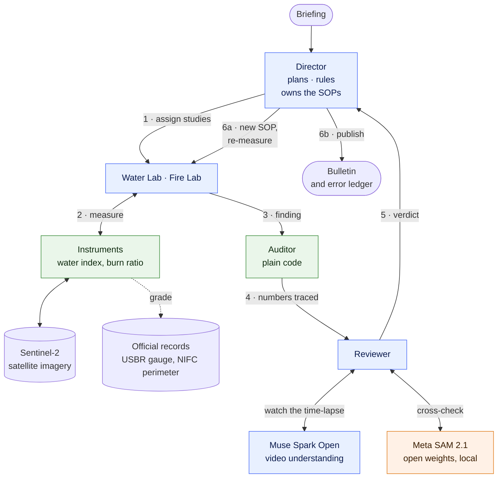

<p align="center"></p>

# Orbital

**AI science labs that catch their own mistakes.** Built for the Meta Global AI Developer Hackathon
(problem statement: *Push the Frontier*).

Satellites photograph every lake and wildfire on Earth every few days, for free, but turning those pixels into
numbers people can trust still takes a team of scientists, and AI that measures things will confidently get them
wrong unless something checks its work. Orbital is a one-person Earth-science institute run by AI agents on Meta's
Muse Spark Open: its labs measure lakes and burn scars from Sentinel-2 imagery, a Reviewer watches the evidence as
video and cross-checks it with Meta's SAM 2.1, and a deterministic Auditor traces every number back to the tool
that produced it. When the institute finds a flaw in its own method, the Director runs a methods study, issues a
new versioned procedure, and the labs measure again before anything is published, mistakes included. In its latest
fully autonomous cycle, Lake Mead's agreement with the official gauge went from r 0.27 to 0.96, and the Tartar
Fire burn map's overlap with the official perimeter went from 0.66 to 0.90.

**▶ [Watch the demo video](https://www.youtube.com/watch?v=vb0DcCscftc) ·
[Replay a full autonomous cycle in your browser](https://orbital-x-nine.vercel.app)** (no install, no keys)

<p align="center">
  
  
  
  
  
</p>

## Results from one autonomous cycle

Cycle-8, the run in the live replay above: two questions in, no human in the loop, 18 minutes end to end
(reusing satellite measurements that earlier cycles had cached).

| Study | Default procedure (v1) | After the Director's fix |
|---|---|---|
| Lake Mead surface area vs the USBR gauge, 2018–2026 | Pearson r **0.27**, scatter ±49.6 km² (73 months) | Pearson r **0.96**, scatter ±7.0 km², all 73 months kept |
| Tartar Fire (Idaho, 2026) burn map vs the official perimeter | IoU **0.66**, precision 0.69, 267 km² mapped outside | IoU **0.90**, precision 0.97, 21 km² outside; 613 km² = 96% of the official area |

- **Caught:** in winter scenes Lake Mead rendered black, and the water index missed most of it. On 2025-02-18 it
  counted 5.6 km² of water while SAM 2.1 outlined 262 km². The fire map counted farm fields and land across the
  Snake River as burned. The Reviewer sent both studies back.
- **Fixed:** the Director ran a methods study for each lab and issued new procedures: a dark-water rule for the
  lake, and for the fire, counting only within 1 km of the perimeter and leaving out cropland.
- **Self-corrected:** the Director's first water procedure added a quality gate. Before sending the study back, it
  applied the institute's rule *among procedures that meet the standard, keep the most data* and replaced its own
  procedure with one that keeps every month.
- **Verified:** 42 of 42 claimed numbers traced to tool outputs. The published bulletin explains how the
  institute caught its own mistakes and keeps the caveats that remain, such as one month the fix over-counts; the
  error ledger lists all 11 problems.

## Architecture



Blue: Meta Muse Spark Open, served by Baseten. Orange: Meta SAM 2.1, run locally. Green: plain code.

1. The **Director** reads a briefing and assigns one focused study per question.
2. The **Water Lab** measures a lake's surface month by month (MNDWI water index, cross-checked against ESA's
   scene classification and a local threshold). The **Fire Lab** maps a burn scar from the change in Normalized
   Burn Ratio between clear pre- and post-fire scenes. Both grade themselves against official records.
3. The **Auditor**, plain code with no model, checks that every number a lab claims appears in that lab's own tool
   outputs.
4. The **Reviewer** watches the whole series as a time-lapse, cross-checks every month with SAM 2.1, inspects
   flagged frames, re-measures from raw imagery, and applies publication standards (r ≥ 0.8 with the gauge;
   IoU ≥ 0.75 with the perimeter and ≤ 10% of it mapped outside).
5. The **Director** publishes, or fixes the procedure from evidence: it scores variants in a methods study, then
   issues a versioned standard operating procedure (SOP) that every lab follows, and sends the study back.
6. A **bulletin** reports the findings with an error ledger of what the institute caught in its own work.

Every step is written to an append-only event log, which **mission control** (FastAPI and plain JavaScript)
streams live: each agent's reasoning, tool calls, images, verdicts and procedure changes.

## Sponsors used

| Sponsor | What we used | Its job in Orbital |
|---|---|---|
| **Meta** | **Muse Spark Open** (`meta-models/muse-spark-open-1026`, open weights) | Runs every agent: tool calling, vision over satellite evidence, video understanding of time-lapses, reasoning about procedures |
| **Meta** | **SAM 2.1** (`facebook/sam2.1-hiera-small`, open weights) | A second, independent lake instrument, run locally on CPU |
| **Baseten** | Inference for Muse Spark Open (OpenAI-compatible API) | Serves every agent call: chat with tools, reasoning output, image and video input, parallel requests |
| **AssemblyAI** | Text-to-speech and speech-to-text | Demo video only: narration, and a check that the figures were spoken correctly |

### Meta: Muse Spark Open

Every agent in Orbital is Muse Spark Open: the Director, the Water Lab, the Fire Lab and the Reviewer.

- **Agents with tools.** Each agent runs a multi-step tool-calling loop (up to 20 steps, 24 for the Reviewer).
  Cycle-8 made 83 tool calls: measuring a series, grading it against the gauge, viewing evidence, re-measuring a
  date from raw imagery, running a methods study, issuing a procedure. Structured results (findings, reviews,
  procedures) come back as tool calls, so they are typed.
- **Vision.** Agents look at the evidence behind a number: true-colour images with the measured water outlined,
  and burn-severity maps with the official perimeter drawn on. The Reviewer used these to spot fields and land
  across the Snake River mapped as burned.
- **Video understanding as an audit tool.** `watch_timelapse` turns the measured series into MP4 clips of 24
  months at 2 s per frame and sends them to the model in parallel. Each frame's caption carries the date and the
  measured area, so every flag maps back to a real data point; a misread caption cannot invent a month. In
  cycle-8 the Reviewer watched 73 months in 4 clips in 34 s and flagged 14, including all three black-lake
  failures (2020-10-22, 2021-01-30, 2025-02-18).
- **Reasoning about method.** The Director reads methods-study tables (6 water-detection variants scored against
  the gauge; 24 burn-mapping variants scored against the perimeter) and turns them into procedure changes with a
  stated reason. Its reasoning at every step appears in the lab notebook.
- **Optional:** the Director and Reviewer can run on Muse Wonder or Muse Spark 1.3 through the Meta Model API
  (`ORBITAL_META_ROLES=1` and `MODEL_API_KEY`); every run reported here used Muse Spark Open.

Code: `orbital/agents/runtime.py` (the agent loop), `orbital/agents/director.py`, `orbital/agents/water_lab.py`
(including `watch_timelapse`), `orbital/agents/fire_lab.py`, `orbital/agents/reviewer.py`.

### Meta: SAM 2.1

A second Meta model works as a second instrument. `sam_check` runs Segment Anything 2.1 locally (about 2 s per
month on 4 CPU cores, cached per date) to outline the lake in each month's true-colour image. Its only prompts are
up to ten points deep inside what ESA WorldCover maps as permanent water; prompt points that look dry or cloudy in
that month's image are dropped. It never sees the water index, so it fails in different ways, which is the point
of an independent check. Measured on the stored series (`scripts/sam_eval.py`):

| Series | Water index vs gauge | SAM 2.1 vs gauge | Months where the two outlines disagree (IoU < 0.5) |
|---|---|---|---|
| Default procedure, 73 months | r 0.27, ±49.6 km² | r **0.92**, ±9.0 km² | exactly the three black-lake failures: 2025-02-18 (IoU 0.01), 2020-10-22 (0.17), 2021-01-30 (0.19); every other month ≥ 0.71 |
| After the fix (dark-water rule), 73 months | r 0.96, ±7.0 km² | r 0.91, ±8.9 km² | none |

The disagreement needs no gauge, so the same check works on the many lakes that have none. After the fix, SAM
still earned its place: when the time-lapse review flagged 2021-01-30 as an over-count (374.5 km²), SAM's outline
(337 km²) gave the size of the error, and the bulletin discloses it.

Code: `orbital/instruments/sam.py` (prompts, segmentation, comparison images) and `sam_check` in
`orbital/agents/water_lab.py`. SAM 3.1 through the Meta Model API could replace it behind the same tool.

### Baseten

Baseten serves Muse Spark Open for the hackathon (`https://inference.baseten.co/v1`), and Orbital calls it with
the standard OpenAI client.

- **Chat completions with tools** for every agent step, with retries and exponential backoff.
- **Reasoning output** (`reasoning_content`) is shown in mission control as each agent's thoughts: 55 of them in
  cycle-8.
- **Image input** for evidence, kept to the deployment's 8 images per request (older images give way to newer
  ones).
- **Video input:** the time-lapse clips go up as MP4 data URIs in `video_url` parts.
- **Parallel requests:** both labs work at the same time, reviews run side by side, and time-lapse clips are
  watched in parallel. With satellite measurements cached, cycle-8's two rounds took 18 minutes.
- **Deployment quirk:** `response_format=json_schema` degenerated into whitespace here, so every structured result
  comes back through a tool call instead.

Code: `orbital/llm.py` and `orbital/config.py`.

### AssemblyAI

Used only for the demo video, not by the institute. The narration script is generated from the run's own outputs
(`scripts/demo/scenes.py`), so no number in the video is typed by hand. AssemblyAI text-to-speech voices each scene
(`scripts/demo/tts.py`), and we transcribed the narration back with its speech-to-text (Universal-3.5 Pro) to check
that the figures were spoken correctly. Playwright records mission control replaying the run, and ffmpeg lays the
narration over it.

## Run it

```bash
uv sync --extra sam
```

The `sam` extra adds CPU PyTorch and Transformers for SAM 2.1 (its weights download once, about 180 MB). Without
it, everything else works and `sam_check` reports that it is not installed. Set `BASETEN_API_KEY`, then start
mission control and press **Run a new cycle**:

```bash
uv run uvicorn orbital.web:app --port 8000
```

The first cycle measures 106 months of imagery from scratch, so it takes longer than later cycles, which reuse
those measurements. Or run a cycle from the command line:

```bash
uv run python -m orbital.institute
```

Baselines and methods work need no model keys:

```bash
uv run python scripts/lake_mead.py 2
```

```bash
uv run python scripts/water_methods_eval.py runs/lake-mead/water-sop-1-764ec8/series.json
```

Tests (no network or model calls):

```bash
uv run pytest
```

## Repository layout

```
orbital/
  imagery/       Sentinel-2 search (Earth Search STAC), per-day mosaics, indices, rendering
  instruments/   water extent, burn severity (versioned SOPs), SAM 2.1 lake outlines
  truth/         USBR reservoir records, NIFC fire perimeters, ESA WorldCover land cover
  studies/       month-by-month series, fire pre/post study, grading and charts
  agents/        tool-calling runtime, Director, Water Lab, Fire Lab, Reviewer, number audit
  institute.py   one research cycle: plan → measure → audit → review → rule → re-measure → bulletin
  web.py         mission-control API
web/             mission-control front end, Capy mascots, demo slides
scripts/         baselines, methods studies, SAM evaluation, static replay export, demo video pipeline
tests/           fast checks of the instruments, procedures, audit and runtime
```

## What earlier cycles taught us

Every cycle before cycle-8 exposed a flaw that is now fixed in the code:
- a Reviewer that ran out of steps (now it is warned and, near the end of its budget, can only submit);
- a Director that sent work back without changing the procedure (now refused by a guard);
- a Director that guessed a fire threshold instead of measuring one (now it runs the fire methods study);
- a quality gate that measured the wrong thing (replaced by one checked against ESA's classification);
- a stale settings file that crashed re-measurement (the lab reported the failure instead of inventing numbers);
- a Reviewer that wrote its verdict as text and then re-ran its checks (now told plainly that text is not a
  submission).

## Data and credits

- Contains modified Copernicus Sentinel data 2018–2026 (Sentinel-2 L2A via Element 84 Earth Search on AWS Open
  Data).
- U.S. Bureau of Reclamation, Lake Mead end-of-month elevations. NIFC WFIGS interagency fire perimeters.
- ESA WorldCover 2021 (CC BY 4.0). SAM 2.1 by Meta (Apache-2.0), via Hugging Face Transformers.
- Capy the capybara is original SVG drawn in code (`scripts/make_mascot.py`).

## Limitations

- Lake areas are measured at 40 m. Scenes that fail quality gates are rejected rather than guessed: 73 of 106
  months pass the default gates.
- Fire maps compare one pre-fire and one post-fire scene. Perimeters include unburned islands, so the burned area
  is expected to come in below the official area.
- SAM 2.1 cross-checks the water instrument but is not itself a procedure option, and its outline runs about 5%
  wider than the water index (shoreline pixels).
- Only Lake Mead is configured as a water target today. Adding a lake takes a bounding box in `orbital/targets.py`,
  and SAM can cross-check it without a gauge, but grading it against a gauge needs that lake's records wired in.

Everything in this repository was written during the hackathon. The repository was created on Oct 30, 2026; its
first commit holds only a `.gitattributes` file.
