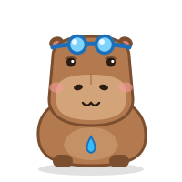
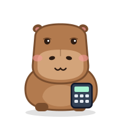

<p align="center"></p>

# Orbital

**A one-person Earth-science institute, run by AI labs on Meta's Muse models.**

Orbital turns free satellite imagery into *verified* measurements of the planet. A Director agent plans studies,
lab agents measure lakes and wildfires from Sentinel-2, a Reviewer signs off on every finding, and a deterministic
Auditor traces every number back to the tool that produced it. When the institute finds a flaw in its own methods,
the Director issues a new standard operating procedure (SOP), the labs re-measure, and the bulletin says what was
caught.

Built for the **Meta Global AI Developer Hackathon** (problem statement: *Push the Frontier*). Everything in this
repository was written during the hackathon; the repository started empty (see the commit history).

<p align="center">
  
  
  
  
  
</p>

## What one research cycle looks like

1. **Director** reads a briefing and assigns one focused study per question to a lab.
2. **Labs** measure with real instruments (tools), all on free data with no keys:
   - **Water Lab** — monthly lake surface area from Sentinel-2 (MNDWI, cross-checked against ESA's scene
     classification and a locally fitted threshold), graded against the U.S. Bureau of Reclamation's gauge.
   - **Fire Lab** — burn scar and severity from the change in Normalized Burn Ratio between clear pre- and
     post-fire scenes, graded against the official NIFC fire perimeter.
3. **Auditor** (plain code, no model) checks that every value a lab claims appears in that lab's own tool outputs.
4. **Reviewer** verifies each claim, *watches* the whole measured series as a satellite time-lapse (video
   understanding), cross-checks every month with a second instrument (Meta's SAM 2.1, run locally), inspects every
   flagged frame, re-measures key numbers from raw imagery, and applies the
   institute's publication standards (e.g. lake area must track the gauge at r ≥ 0.8; a burn map must overlap the
   perimeter at IoU ≥ 0.75).
5. **Director** rules: publish, or fix the procedure from evidence (a methods study, a versioned SOP that every lab
   follows) and send the study back.
6. A **bulletin** is published with the findings and an error ledger of what the institute caught in its own work.

## Results (cycle-7, a full autonomous run; the one in the demo video)

Measured by the labs on real data. Under the default procedures the Reviewer sent both studies back; the Director
ran a methods study for each lab, issued new SOPs, and both re-measured studies passed review in round 2. The
institute logged 12 problems in its own work, and every claimed number traced back to a tool output (44 of 44).

| Study | Default SOP (v1) | SOP issued by the Director |
|---|---|---|
| Lake Mead surface area vs USBR gauge, 2018–2026 | Pearson r **0.27**, scatter ±49.6 km² (73 months) | Pearson r **0.98**, scatter ±5.1 km² (39 months), water-sop-3 |
| Tartar Fire (Idaho, 2026) burn map vs official perimeter | IoU **0.66**, precision 0.69, 267 km² outside | IoU **0.89**, precision 0.96, 26 km² outside, fire-sop-2 |

- **How v1 was caught:** the Reviewer *watched* all 73 measured months of the lake as a time-lapse with Muse Spark
  Open's video understanding, flagged the months where the lake rendered black and the outline missed it
  (2020-10-22, 2021-01-30, 2025-02-18), confirmed them frame by frame with `view_evidence`, and re-measured points
  from raw imagery. For the fire it found 267 km² mapped as burned outside the official perimeter.
- **What went wrong in v1, water:** in low-sun winter scenes the atmospheric correction drives Lake Mead's
  reflectance to near zero in every band. The water index turns to noise and most of the lake is missed
  (5.6 km² measured on 2025-02-18). The water methods study (6 detection variants on 42 test dates) showed a dark-water
  rule restores agreement with the gauge (plain water index r −0.04, with the rule r 0.92), and its quality-gate
  table showed what stricter scene selection costs in months and gains in agreement.
- **The Director corrected itself.** It first issued water-sop-2 (dark-water rule; at most half the lake
  near-black; outline overlaps ESA's own water classification at IoU ≥ 0.8). Before sending the study back it
  applied the institute's rule *among procedures that meet the standard, keep the most data* to the gate table it
  already had, and issued water-sop-3 with IoU ≥ 0.75: 39 months instead of about 30, still r 0.98. The cost of
  the gates is stated plainly: 39 of 106 months pass (only 2 in 2023).
- **What went wrong in v1, fire:** crop harvest, seasonal drying and land across the Snake River were mapped as
  burned. The fire methods study scores procedure variants against the perimeter in seconds; counting only within
  1 km of the incident's perimeter scored best (IoU 0.89, 620 km², 97% of the official area). Since cycle-7 the
  study also scores an ESA WorldCover cropland mask: on this fire it adds little (IoU 0.90), because only 1.3 km²
  of the perimeter is farmland.
- **Context the Water Lab reported:** USBR's end-of-month record shows Lake Mead at 1,037.8 ft on 2026-09-30,
  its lowest since 1940, below the July 2022 low of 1,040.92 ft.
- **Earlier cycles** each exposed a flaw that is now fixed in the code: a reviewer that ran out of steps, a
  Director that sent work back without changing the procedure (now refused by a guard), a Director that guessed a
  fire threshold instead of measuring one (now it runs the fire methods study), a quality gate that measured the
  wrong thing, and a stale settings file that crashed re-measurement (the lab reported the failure instead of
  inventing numbers).

A static, key-free replay of an earlier run (cycle-5): [hack-metam-static](https://github.com/chinesepowered/hack-metam-static).

## Meta models

| Role | Model | How it is used |
|---|---|---|
| Director, labs, reviewer | **Muse Spark Open** (`meta-models/muse-spark-open-1026`, open weights, served by Baseten) | Tool calling, multi-step agent loops, vision over satellite evidence images, **video understanding** (skimming 8 years of monthly time-lapse in parallel clips to find the months an instrument got wrong), reasoning |
| Water Lab and Reviewer's second instrument | **SAM 2.1** (`facebook/sam2.1-hiera-small`, open weights, Apache-2.0, run locally on CPU) | Outlines the lake in each month's satellite image, prompted only by points ESA WorldCover maps as permanent water; it never sees a spectral index, so it fails differently from the water index (`sam_check`) |
| Director / reviewer, optional | Muse Wonder / Muse Spark 1.3 (Meta Model API) | Opt in with `ORBITAL_META_ROLES=1` and `MODEL_API_KEY` (see `orbital.institute.roles()`) |

Structured results come back through tool calls rather than `response_format=json_schema`, which degenerates into
whitespace on the Baseten deployment. Evidence images are capped at 8 per request, the deployment's limit.

**Video review, measured.** `watch_timelapse` turns the measured series into clips of 24 months at 2 s per frame
(the model samples about one frame per second) and reviews them in parallel. In cycle-7 the Reviewer watched the
flawed v1 series (73 months, 4 clips, 28 s) and flagged 14 months, including all three dark-water failures with
exact dates (2020-10-22, 2021-01-30, 2025-02-18). On the 39-month water-sop-3 series it flagged three isolated
months (a thin false-water line, a gap in a narrow channel, cloud shadow); the Reviewer confirmed them with
`view_evidence`, judged them not systematic, and the bulletin discloses them. Flags are matched to real data
points by date and printed area, so a misread caption cannot invent a month.

**A second Meta model as a second instrument.** `sam_check` runs SAM 2.1 locally (about 2 s per month on 4 CPU
cores, cached per date) and compares its outline with the water index month by month. Measured on the stored
series (`scripts/sam_eval.py`):

| Series | Water index vs gauge | SAM 2.1 vs gauge | Months where the two disagree (outline IoU < 0.5) |
|---|---|---|---|
| Default SOP, 73 months | r 0.27, ±49.6 km² | r **0.92**, ±9.0 km² | exactly the three dark-water failures: 2025-02-18 (IoU 0.01), 2020-10-22 (0.17), 2021-01-30 (0.19); every other month ≥ 0.71 |
| water-sop-3, 39 months | r 0.98, ±5.1 km² | r 0.96, ±6.5 km² | none |

So SAM finds the instrument's failures without a gauge, which matters for the many lakes that have no gauge.

## Run it

```bash
uv sync --extra sam
```

The `sam` extra adds CPU PyTorch and Transformers for SAM 2.1 (weights download once, about 180 MB); without it
everything else works and `sam_check` reports that it is not installed. Set `BASETEN_API_KEY` (required) and optionally `MODEL_API_KEY`. Then start mission control and press
**Run a new cycle**:

```bash
uv run uvicorn orbital.web:app --port 8000
```

Or run a cycle from the command line:

```bash
uv run python -m orbital.institute
```

Baselines and methods work, no model keys needed:

```bash
uv run python scripts/lake_mead.py 2
```

```bash
uv run python scripts/water_methods_eval.py runs/lake-mead/water-sop-1-764ec8/series.json
```

Tests (no network or model calls):

```bash
uv run pytest
```

Demo video pipeline: `scripts/demo/` (narration text generated from the run's outputs, AssemblyAI text-to-speech,
Playwright screen capture, ffmpeg).

## Layout

```
orbital/
  imagery/       Sentinel-2 search (Earth Search STAC), per-day mosaics, indices, rendering
  instruments/   water extent, burn severity (versioned SOPs), SAM 2.1 lake outlines
  truth/         USBR reservoir records, NIFC fire perimeters, ESA WorldCover land cover
  studies/       month-by-month series, fire pre/post study, grading and charts
  agents/        tool-calling runtime, director, water lab, fire lab, reviewer, number audit
  institute.py   one research cycle: plan → measure → audit → review → rule → re-measure → bulletin
  web.py         mission-control API
web/             mission-control front end, Capy mascots, demo slides
scripts/         baselines, methods study, mascot generator, demo video
```

## Data and credits

- Contains modified Copernicus Sentinel data 2018–2026 (Sentinel-2 L2A via Element 84 Earth Search on AWS Open Data).
- U.S. Bureau of Reclamation, Lake Mead end-of-month elevations. NIFC WFIGS interagency fire perimeters.
- ESA WorldCover 2021 (CC BY 4.0). SAM 2.1 by Meta (Apache-2.0), via Hugging Face Transformers.
- Capy the capybara is original SVG drawn in code (`scripts/make_mascot.py`).
- Demo narration: AssemblyAI text-to-speech.

## Limitations

- Lake areas are measured at 40 m; scenes that fail quality gates are rejected rather than guessed (73 of 106 months
  pass the default gates, 39 pass the stricter gates of cycle-7's water-sop-3, only 2 of them in 2023).
- Fire maps compare one pre-fire and one post-fire scene; perimeters include unburned islands, so burned area is
  expected to be below the official area.
- SAM 2.1 cross-checks the water instrument but is not itself an SOP option, and its outline runs about 6% wider
  than the water index (shoreline pixels). SAM 3.1 via the Meta Model API would slot into the same tool.
